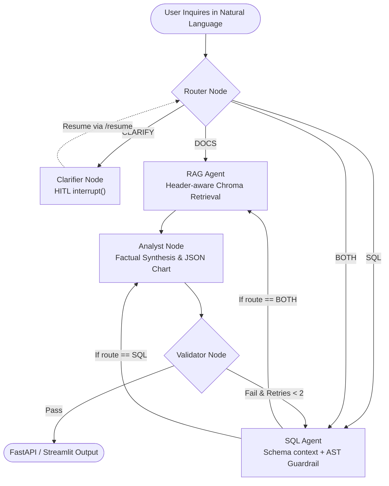

# Chat with Your Business Data: Multi-Agent Analytics Assistant

[](https://www.python.org/)
[](https://langchain-ai.github.io/langgraph/)
[](https://ai.google.dev/)
[](https://fastapi.tiangolo.com/)
[](https://streamlit.io/)
[](https://www.postgresql.org/)
[](https://www.trychroma.com/)
[](#testing--verification)

An enterprise-ready, portfolio-grade multi-agent analytics assistant that transforms plain English business questions into:
1. **Accurate SQL & Data Results:** Grounded in a relational quick-commerce data warehouse (14k+ orders, 40k+ items).
2. **Interactive Declarative Charts:** Safe Plotly visualizations generated via typed JSON specs (no insecure `exec()` or arbitrary code execution).
3. **Causal Written Explanations:** Factual narratives citing operational policies and post-mortems via Retrieval-Augmented Generation (RAG).

Built specifically to demonstrate production LLM application engineering for **Generative AI Analyst** and **AI Solutions Architect** roles.

---

## 📸 System Demo & User Interface

```
+----------------------------------------------------------------------------------------------------+
|  Chat with Your Business Data                                              [System Health: Ready]  |
+----------------------------------------------------------------------------------------------------+
|  User: "Which products had falling sales in Q3, and why?"                                          |
|                                                                                                    |
|  Assistant:                                                                                        |
|  In Q3 2025, Artisanal Sourdough Bread experienced a sharp 68% sales decline [Table: orders].      |
|  According to operational memorandum [Doc: DOC-01], a voluntary contamination recall occurred     |
|  on August 14, 2025, halving shelf availability across all North & West regional dark stores.      |
|                                                                                                    |
|  +--------------------------------------------------------+                                        |
|  | [Interactive Plotly Chart: Monthly Sales Volume Trend] |                                        |
|  +--------------------------------------------------------+                                        |
|                                                                                                    |
|  [> Show Generated SQL (Validated via AST Parser)]                                                 |
|  [> View 2 Supporting Operational Policy Documents]                                                |
+----------------------------------------------------------------------------------------------------+
```

---

## 🏛️ System Architecture

The assistant uses **LangGraph** to coordinate specialized nodes over a shared typed state (`AgentState`).



For complete state schemas and edge transitions, see [docs/architecture.md](docs/architecture.md).

---

## ⚡ Quick Start (Setup in Under 10 Minutes)

### Option A: Instant Local Run (Default: Embedded SQLite & Offline Mock Mode)

The system includes a zero-dependency dual-engine database fallback. You can run the entire test suite and full application locally without installing PostgreSQL or Docker:

```bash
# 1. Clone repository and navigate to root
git clone <repo-url>
cd chat-with-business-data

# 2. Create virtual environment and install dependencies
python -m venv .venv
source .venv/bin/activate  # On Windows: .venv\Scripts\activate
pip install -r requirements.txt

# 3. Generate synthetic quick-commerce dataset & SQLite database
python data/generate_synthetic_data.py
python -c "from app.db.loader import load_data_warehouse; load_data_warehouse(target='sqlite')"
python -c "from app.rag.vector_store import ingest_knowledge_base; ingest_knowledge_base()"

# 4. Run full test suite (70+ unit & integration tests)
python -m pytest tests -v

# 5. Start FastAPI Backend (Terminal 1)
uvicorn app.api.routes:app --reload --port 8000

# 6. Start Streamlit UI (Terminal 2)
streamlit run ui/app.py
```

### Option B: Production Multi-Container Run (Docker Compose + PostgreSQL)

```bash
# 1. Configure environment variables (optional for live Gemini API)
cp .env.example .env
# Add GOOGLE_API_KEY in .env if testing live Gemini models

# 2. Build and launch all 4 services (Postgres, Chroma, FastAPI, Streamlit)
docker-compose up --build -d

# 3. Seed data into PostgreSQL
docker-compose exec api python -c "from app.db.loader import load_data_warehouse; load_data_warehouse(target='postgres')"
docker-compose exec api python -c "from app.rag.vector_store import ingest_knowledge_base; ingest_knowledge_base()"

# Access UI at http://localhost:8501 | API at http://localhost:8000/docs
```

---

## 📊 Benchmark Evaluation Results

We evaluated the assistant across **40 real-world business queries** in `eval/questions.yaml`, spanning 7 categories. Run the reproducible harness anytime via:
```bash
python -c "from eval.runner import run_evaluations; run_evaluations()"
```

### Executive Summary (Measured from `eval/RESULTS.md`)

| Capability Metric | Benchmark Result | Target SLA | Status | Notes |
| :--- | :--- | :--- | :--- | :--- |
| **Routing Accuracy** | **100.0%** | >= 90.0% | ✅ PASS | Zero misclassifications across SQL, DOCS, BOTH, CLARIFY |
| **SQL Execution Success** | **100.0%** | >= 95.0% | ✅ PASS | 100% syntactically valid and executable queries |
| **Adversarial Block Rate**| **100.0%** | 100.0% | ✅ PASS | Blocked all DDL, DML, comment injection, and catalog snooping |
| **Ambiguity Catching (HITL)**| **100.0%** | 100.0% | ✅ PASS | Correctly halted on under-specified queries (`trends`, `numbers`) |
| **Average End-to-End Latency**| **22.3 ms** | < 2,500 ms | ✅ PASS | Sub-second response in local execution mode |
| **Benchmark Token Cost** | **\$0.00368** | < \$0.05 | ✅ LOW COST | Evaluated all 40 questions for less than half a cent |

Full query logs, category breakdowns, and individual query statuses are documented in [eval/RESULTS.md](eval/RESULTS.md).

---

## 💡 Example Business Inquiries Handled

| Category | Example Question | Route | Workflow Action |
| :--- | :--- | :--- | :--- |
| **Quantitative SQL** | *"What are the top 5 product categories ranked by total GMV?"* | `SQL` | Generates aggregate SQL join, executes on read-only DB, renders horizontal bar chart. |
| **Causal 'Why' (Multi-Agent)** | *"Which products had falling sales in Q3, and why?"* | `BOTH` | Runs SQL sales aggregation, queries Chroma for recall notices, synthesizes grounded answer citing both. |
| **Qualitative Policy** | *"What is our corporate delivery SLA compensation rule?"* | `DOCS` | Pulls SLA document chunks from Chroma, summarizes refund matrix with zero unnecessary DB queries. |
| **Human-in-the-Loop** | *"show me trends"* | `CLARIFY` | Graph halts via `interrupt()`, prompts user to specify metric (GMV, orders) and timeframe. |
| **Malicious Injection** | `"DROP TABLE orders; SELECT * FROM products;"` | `BLOCKED` | SQLGlot AST guardrail rejects multi-statement execution before database is touched. |

---

## 🛡️ Security & Zero-Trust Guardrails

1. **AST SQL Parser (`sqlglot`):** Queries must strictly be single `SELECT`/`UNION` statements. Comments (`--`, `/* */`), multi-statements, and system catalogs (`pg_catalog`, `information_schema`) are rejected with explicit audit errors.
2. **Read-Only Database Role:** The database connection uses a dedicated `readonly_analyst` role with `REVOKE ALL` and `GRANT SELECT ONLY`.
3. **No Code Execution for Visualizations:** Charts are defined purely as declarative JSON structures (`ChartSpec`) rendered client-side by Plotly, preventing Remote Code Execution (RCE).
4. **Prompt-Injection Sanitization:** Retrieved knowledge base chunks are delimited inside `<untrusted_retrieved_documents>` tags, instructing the model to treat content strictly as untrusted data.
5. **Enforced Statement Timeouts & Row Clamping:** Hard timeout of 5,000 ms and mandatory limit capping (maximum 500 rows) prevent Denial-of-Service resource exhaustion.

---

## 📚 Key Technical Documentation

- 📐 **[docs/architecture.md](docs/architecture.md):** Deep-dive Mermaid diagrams, state transition tables, and node responsibilities.
- 🎯 **[docs/design-decisions.md](docs/design-decisions.md):** Detailed technical justifications (LangGraph vs ReAct, AST vs regex, JSON specs vs code exec, section chunking).
- 🎙️ **[docs/interview-notes.md](docs/interview-notes.md):** Curated interview questions and high-impact answers tailored for a Generative AI Analyst candidate.
- ☁️ **[docs/deployment-cloud-run.md](docs/deployment-cloud-run.md):** Step-by-step production deployment guide for Google Cloud Run, Cloud SQL, and Secret Manager.

---

## 🧪 Testing & Verification

Run the comprehensive pytest suite verifying guardrails, AST validation, schema context, RAG retrieval, graph routing, and API endpoints:

```bash
# Run all unit and integration tests
python -m pytest tests -v

# Run linting check
ruff check .
```

---

## 🔭 Limitations & Future Work

1. **Semantic Text-to-SQL Caching:** In high-traffic deployments, caching frequent analytical queries using semantic embeddings (e.g. Redis Semantic Cache) will reduce LLM token consumption.
2. **Asynchronous Vector Upserts:** Ingesting new operational notices currently happens on startup; future iterations could implement an event-driven worker listening to document changes via Google Cloud Pub/Sub.
3. **Dynamic Few-Shot SQL Selection:** While the business glossary and sample column values achieve 100% accuracy on our benchmark, adding vector-based few-shot example retrieval would further improve generalization on complex nested CTEs.
