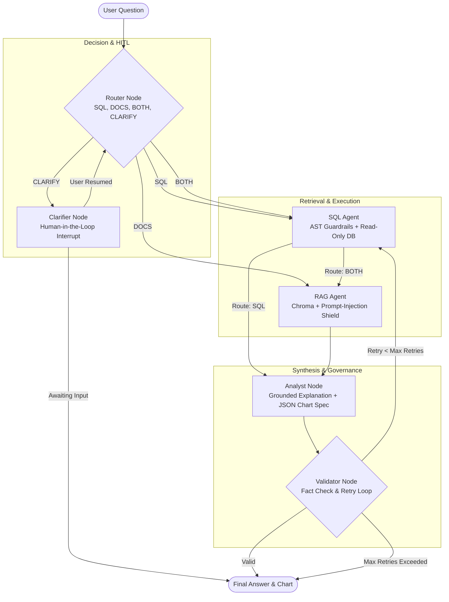

# Architecture & StateGraph Specification

"Chat with Your Business Data" is designed as a stateful, multi-agent orchestration graph built with **LangGraph**. The workflow dynamically inspects incoming user queries, routes them across specialized agent nodes, coordinates SQL querying against relational data and vector semantic search across business documentation, validates facts, and loops for self-correction.

---

## 1. Multi-Agent Workflow (Mermaid Diagram)

---

## 2. Typed State Definition

All graph transitions share a unified `AgentState` schema ([app/graph/state.py](file:///C:/Users/pc/.gemini/antigravity/scratch/chat-with-business-data/app/graph/state.py)):

| State Attribute | Type | Description |
| :--- | :--- | :--- |
| `question` | `str` | Current active user question (or merged with clarification). |
| `route` | `Literal["SQL", "DOCS", "BOTH", "CLARIFY"]` | Dynamic decision path chosen by Router. |
| `sql_query` | `str | None` | Generated & sanitized read-only SQL SELECT statement. |
| `sql_columns` | `list[str]` | Column names returned from database execution. |
| `sql_rows` | `list[list[Any]]` | Data rows formatted as JSON primitives. |
| `retrieved_docs` | `list[RetrievedChunk]` | Top-k chunks with metadata (`doc_id`, `section`, `source`). |
| `chart_spec` | `ChartSpec` | Declarative JSON specification for Plotly rendering. |
| `answer` | `str | None` | Final cited markdown response. |
| `is_valid` | `bool` | Validation pass/fail status. |
| `retry_count` | `int` | Number of automated correction iterations (max 2). |
| `needs_clarification`| `bool` | Flag triggering human-in-the-loop interruption. |

---

## 3. Node Responsibilities & Security Boundaries

1. **Router Node (`app/nodes/router.py`)**: Uses structured Pydantic output to classify intent. Prevents unnecessary database calls for qualitative questions and catches ambiguous requests early.
2. **Clarifier Node (`app/nodes/clarifier.py`)**: Pauses the graph using LangGraph checkpoints when queries lack temporal or metric bounds. Resumes seamlessly via thread ID without losing conversational memory.
3. **SQL Agent (`app/nodes/sql_agent.py`)**: Injects dynamic schema context, verifies query syntax against AST guardrails (`sqlglot`), blocks DDL/DML/comments, and executes on a dedicated read-only role with statement timeouts.
4. **RAG Agent (`app/nodes/rag_agent.py`)**: Retrieves top-k chunks from Chroma with a relevance score threshold. Enforces prompt injection defense by isolating external documents inside `<untrusted_document>` tags.
5. **Analyst Node (`app/nodes/analyst.py`)**: Synthesizes data and documents, applies citation mandates (`[Table: ...]` and `[Doc: ...]`), and outputs declarative JSON chart specifications instead of executable code.
6. **Validator Node (`app/nodes/validator.py`)**: Confirms numerical assertions against the SQL result set. If a syntax or fact mismatch occurs, it routes backward to the SQL Agent with exact error diagnostics.
