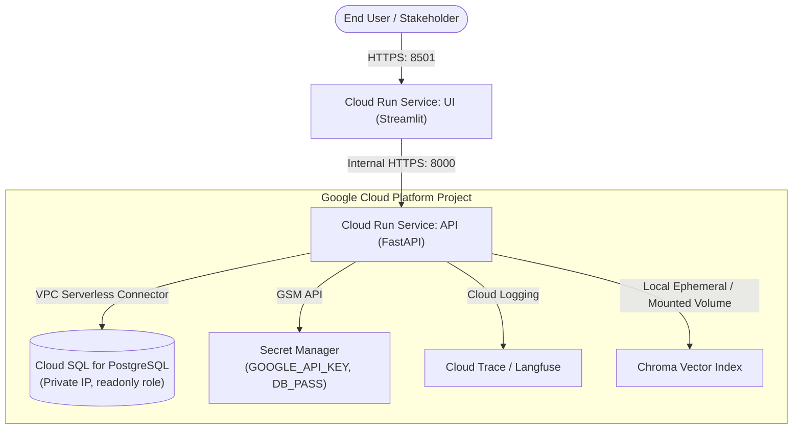

# Google Cloud Run Deployment Guide: Production Multi-Agent Analytics Assistant

This guide covers deploying the **Chat with Your Business Data** architecture to Google Cloud Platform (GCP) using **Cloud Run**, **Cloud SQL (PostgreSQL)**, and **Google Secret Manager**.

---

## 1. Cloud Architecture Overview



---

## 2. Prerequisites & CLI Setup

1. **Google Cloud SDK (`gcloud`)** installed and authenticated:
   ```bash
   gcloud auth login
   gcloud config set project YOUR_GCP_PROJECT_ID
   ```
2. Enable required GCP Service APIs:
   ```bash
   gcloud services enable \
       run.googleapis.com \
       sqladmin.googleapis.com \
       secretmanager.googleapis.com \
       artifactregistry.googleapis.com \
       vpcaccess.googleapis.com \
       compute.googleapis.com
   ```

---

## 3. Provision Cloud SQL (PostgreSQL)

1. **Create the Cloud SQL Instance:**
   ```bash
   gcloud sql instances create business-postgres \
       --database-version=POSTGRES_16 \
       --tier=db-f1-micro \
       --region=us-central1 \
       --storage-size=10GB \
       --storage-type=SSD \
       --root-password="SuperSecretAdminPassword123!"
   ```

2. **Create the Database:**
   ```bash
   gcloud sql databases create business_db --instance=business-postgres
   ```

3. **Apply Schema and Security Roles:**
   Connect via Cloud SQL Auth Proxy or `gcloud sql connect`:
   ```bash
   gcloud sql connect business-postgres --user=postgres --database=business_db < data/init-roles.sql
   gcloud sql connect business-postgres --user=postgres --database=business_db < data/schema.sql
   ```
   > [!IMPORTANT]
   > The `readonly_analyst` role created by `init-roles.sql` has strictly `SELECT` permissions on table schemas and `CONNECT` on `business_db`. The API agent container connects exclusively using this role.

---

## 4. Manage Secrets via Secret Manager

Store sensitive credentials securely without committing them to images or environment files:

```bash
# 1. Google Gemini API Key
echo -n "AIzaSy..." | gcloud secrets create GEMINI_API_KEY --data-file=-

# 2. Readonly Database Connection String
echo -n "postgresql://readonly_analyst:readonly_pass@/business_db?host=/cloudsql/YOUR_GCP_PROJECT_ID:us-central1:business-postgres" | \
    gcloud secrets create DB_READONLY_URL --data-file=-
```

---

## 5. Build and Push Container Images to Artifact Registry

1. **Create Docker Repository in Artifact Registry:**
   ```bash
   gcloud artifacts repositories create analytics-repo \
       --repository-format=docker \
       --location=us-central1 \
       --description="Docker repository for Business Analytics Agent"
   ```

2. **Configure Docker authentication:**
   ```bash
   gcloud auth configure-docker us-central1-docker.pkg.dev
   ```

3. **Build & Push the FastAPI Backend Image:**
   ```bash
   docker build -t us-central1-docker.pkg.dev/YOUR_GCP_PROJECT_ID/analytics-repo/business-api:latest -f Dockerfile.api .
   docker push us-central1-docker.pkg.dev/YOUR_GCP_PROJECT_ID/analytics-repo/business-api:latest
   ```

4. **Build & Push the Streamlit UI Image:**
   ```bash
   docker build -t us-central1-docker.pkg.dev/YOUR_GCP_PROJECT_ID/analytics-repo/business-ui:latest -f Dockerfile.ui .
   docker push us-central1-docker.pkg.dev/YOUR_GCP_PROJECT_ID/analytics-repo/business-ui:latest
   ```

---

## 6. Deploy Backend Service to Cloud Run

Deploy the FastAPI service with Cloud SQL attachment and Secret Manager bindings:

```bash
gcloud run deploy business-api \
    --image=us-central1-docker.pkg.dev/YOUR_GCP_PROJECT_ID/analytics-repo/business-api:latest \
    --region=us-central1 \
    --platform=managed \
    --allow-unauthenticated \
    --memory=1Gi \
    --cpu=1 \
    --min-instances=0 \
    --max-instances=5 \
    --timeout=60s \
    --add-cloudsql-instances=YOUR_GCP_PROJECT_ID:us-central1:business-postgres \
    --set-secrets=GOOGLE_API_KEY=GEMINI_API_KEY:latest,DATABASE_READONLY_URL=DB_READONLY_URL:latest \
    --set-env-vars=DB_TYPE=postgres,STATEMENT_TIMEOUT_MS=5000,GEMINI_MODEL=gemini-2.5-flash
```

Note the deployed URL (e.g. `https://business-api-xyz-uc.a.run.app`).

---

## 7. Deploy Frontend Service to Cloud Run

Deploy the Streamlit UI pointing to the live API URL:

```bash
gcloud run deploy business-ui \
    --image=us-central1-docker.pkg.dev/YOUR_GCP_PROJECT_ID/analytics-repo/business-ui:latest \
    --region=us-central1 \
    --platform=managed \
    --allow-unauthenticated \
    --memory=512Mi \
    --cpu=1 \
    --port=8501 \
    --set-env-vars=API_URL=https://business-api-xyz-uc.a.run.app
```

---

## 8. Verifying Production Deployment

1. **Check Backend Health:**
   ```bash
   curl https://business-api-xyz-uc.a.run.app/health
   # Expected JSON: {"status":"healthy","database":"postgres","db_connected":true,"vector_store_chunks":22}
   ```
2. **Execute a Test Question:**
   ```bash
   curl -X POST https://business-api-xyz-uc.a.run.app/ask \
       -H "Content-Type: application/json" \
       -d '{"question":"What is our total order volume and GMV?"}'
   ```
3. **Open Streamlit UI:**
   Navigate to the URL returned by the `business-ui` deployment in your browser.

---

## 9. Free-Tier Cost Optimization & Guardrails

| GCP Service | Free Tier / Budget Tier Specs | Monthly Cost Estimate |
| :--- | :--- | :--- |
| **Cloud Run** | 2M requests/month free, 360k GB-sec memory | **\$0.00** (scale to 0 when idle) |
| **Cloud SQL** | `db-f1-micro` (1 vCPU, 0.6 GB RAM) shared instance | ~**\$9 - \$11 / month** (stop instance when inactive) |
| **Secret Manager** | 6 active secret versions, 10k access operations/month | **\$0.00** |
| **Artifact Registry**| 0.5 GB/month free storage | ~**\$0.10 / month** |
| **Google Gemini API**| Free tier: up to 15 RPM on `gemini-2.5-flash` | **\$0.00** |
| **Total Estimated Run Cost** | | **~ \$10 / month** (or free with \$300 GCP starter credits) |
